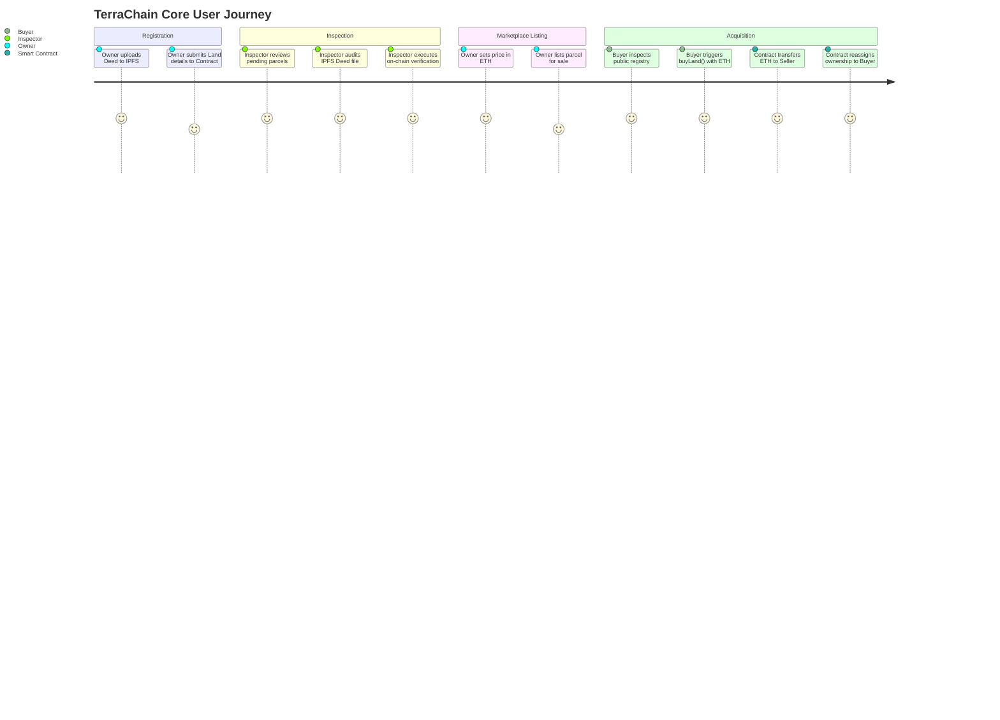

# 01. Project Overview: TerraChain (LandBlock)

## 1. Executive Summary & Purpose

### Simple Language Explanation
TerraChain (LandBlock) is a digital land registry and title transfer system built on blockchain technology. In traditional property registration, land records are maintained in physical government archives or centralized databases prone to record tampering, bribery, forged deed documents, and duplicate sales of the same piece of land. 

TerraChain solves this by replacing manual paper deeds and centralized databases with an immutable smart contract deployed on an Ethereum-compatible network. Landowners upload their digital deed documents to decentralized cloud storage (IPFS), register their property details, and submit them to a government Land Inspector. Once the government inspector verifies the authenticity of the records, the property can be listed on an open marketplace where buyers can purchase land securely with cryptocurrency. The ownership transfer, payment escrow, and deed assignment happen simultaneously in a single, irreversible atomic transaction.

### Technical Explanation
TerraChain is a decentralized application (dApp) leveraging:
1. **Solidity 0.8.20 Smart Contracts** on EVM (Ethereum Virtual Machine) for state transitions, ownership mappings, role-based access control, and atomic ETH settlement.
2. **InterPlanetary File System (IPFS) via Pinata Cloud** for content-addressed, cryptographic storage of cadastral title deeds and legal documentation.
3. **Ethers.js (v6.13.5)** as the Web3 abstraction layer for provider management, JSON-RPC queries, signer transactions, and cryptographic event decoding.
4. **React 18 + Vite** client architecture with role-isolated access portals, Tailwind CSS styling, responsive dark/light theme switching, and real-time wallet synchronization.

---

## 2. Problems Addressed

| Traditional Land Registry Challenge | TerraChain Solution | Evidence in Codebase |
| :--- | :--- | :--- |
| **Tampered / Forged Land Records** | Land records and owner addresses are committed immutably onto EVM blockchain storage. Historical state cannot be rewritten. | `LandRegistry.sol:L28-39` (`struct Land`) |
| **Double Selling of Land** | A seller cannot sell a property twice; the smart contract validates `msg.sender == land.currentOwner` and clears `isForSale` atomically upon purchase. | `LandRegistry.sol:L231-258` (`buyLand`) |
| **Fake Deed Documents** | Deeds are cryptographically hashed using SHA-256 / IPFS CID (Content Identifier) and permanently pinned to decentralized storage. | `frontend/src/services/pinataService.js:L21-65` |
| **Middlemen & Broker Extortion** | Direct peer-to-peer property transfer without intermediaries; funds settle directly to the seller via `call{value: ...}("")`. | `LandRegistry.sol:L252-254` |
| **Lack of Public Transparency** | Anyone with an EVM connection can view all registered lands, verification status, and historical owners. | `LandRegistry.sol:L270-302` (`getLandDetails`) |

---

## 3. Target Stakeholders & User Roles

The system recognizes three primary stakeholder roles:

### A. Government Land Inspector (`admin`)
- **Real-World Entity**: Municipal land registrar, revenue officer, or authorized government inspector.
- **System Authority**: Possesses the exclusive `onlyAdmin` privilege in `LandRegistry.sol`.
- **Primary Capabilities**:
  - Reviews pending land registration requests.
  - Inspects cadastral physical addresses, area measurements, and uploaded deed documents via IPFS gateways.
  - Approves/verifies lands on-chain (`verifyLand(uint256 _landId)`), changing `isVerified` from `false` to `true`.
  - Rejects fraudulent submissions with audit logging.

### B. Property Owner / Seller (`currentOwner`)
- **Real-World Entity**: Individual or corporate landowner seeking to register or monetize real estate.
- **System Authority**: `onlyOwner(landId)` modifier in `LandRegistry.sol`.
- **Primary Capabilities**:
  - Registers new land by submitting property metadata (survey number, district, coordinates, sq. ft.) and deed PDF.
  - Lists verified land for sale at a custom price denominated in ETH (`listForSale(landId, priceInWei)`).
  - Delists properties from the public marketplace if withdrawn (`delistLand(landId)`).
  - Receives direct ETH liquidation upon successful purchase.

### C. Prospective Property Buyer
- **Real-World Entity**: Verified citizen or investor seeking legitimate real estate acquisitions.
- **System Authority**: Standard authenticated EVM account with native currency balance.
- **Primary Capabilities**:
  - Explores the public land marketplace, filtering verified vs. listed parcels.
  - Audits ownership history and verifies deed authenticity via IPFS before purchase.
  - Executes instant atomic land purchase transactions (`buyLand(landId)` payable in ETH).

---

## 4. Primary User Journeys

---

## 5. Current Development Status

- **Development Stage**: Functional Academic Prototype / MVP (Minimum Viable Product).
- **Academic Origin**: MGM University, Department of Computer Science & Engineering, Jawaharlal Nehru Engineering College (Chhatrapati Sambhaji Nagar, India). Academic Year 2024-2025.
- **Operational Status**: 
  - Contracts compile cleanly under Solidity 0.8.20 with Hardhat.
  - Test suite passes with 100% assertions across 5 core suites (16 test specs).
  - Vite frontend operates locally on port 3000 with a dedicated multi-portal login gateway and instant mock/Hardhat credential switching.
- **Major Limitations**:
  - No decentralized governance or multi-signature verification for the inspector role.
  - Reassignment array bug in `_ownerLands` (see `07_SECURITY_AUDIT.md` and `11_BUGS_AND_TECHNICAL_DEBT.md`).
  - No off-chain indexing engine (e.g. The Graph); frontend loops through `totalLands` sequentially.
