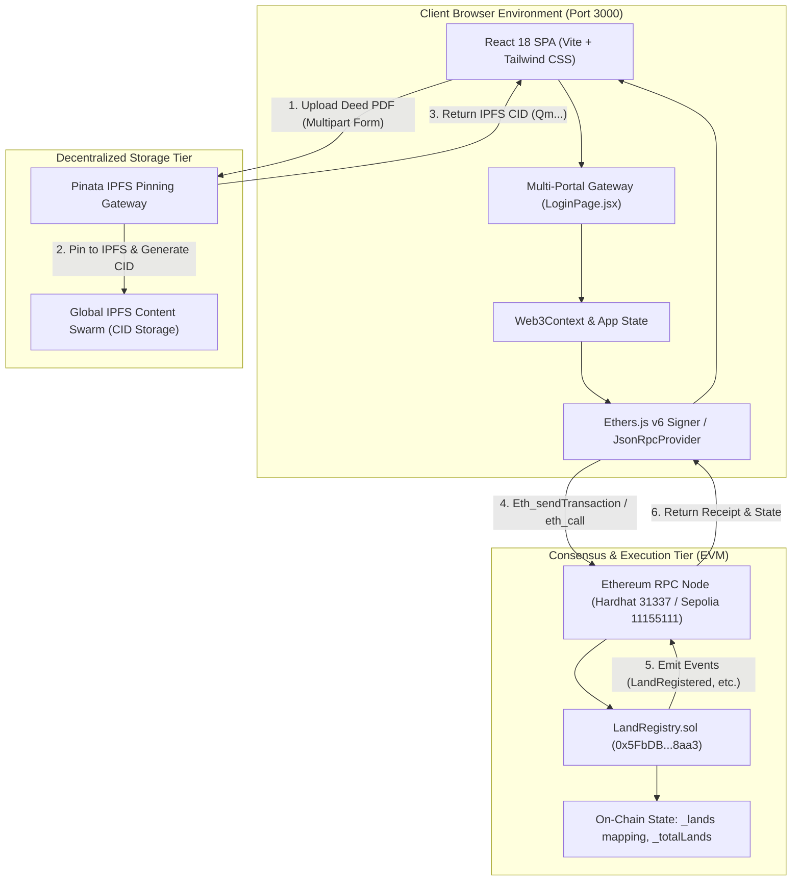
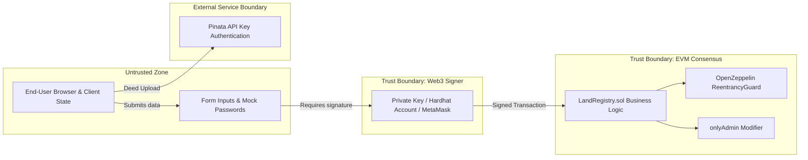

# 02. System Architecture & Data Flow

## 1. Architectural Topology

TerraChain is architected as a **pure decentralized Web3 single-page application (SPA)**. It eliminates traditional centralized database servers and application middleware in favor of direct peer-to-peer interactions between the user's browser, the Ethereum Virtual Machine (EVM), and decentralized IPFS storage nodes.

---

## 2. Component Responsibilities

| Component | Technical Implementation | Core Responsibilities |
| :--- | :--- | :--- |
| **Frontend UI / Portals** | React 18, Lucide React, Tailwind CSS | Provides tailored user portals (`inspector`, `seller`, `buyer`), input validation, deed upload zones, modal management, and theme toggling. |
| **Authentication Gateway** | `frontend/src/components/LoginPage.jsx` | Isolates roles, validates demo credentials, assigns Ethereum testnet identities, and provides auto-fill presets. |
| **Web3 Abstraction Layer** | Ethers.js v6 (`frontend/src/context/Web3Context.jsx`) | Manages JSON-RPC connection to `http://127.0.0.1:8545`, manages contract instances, and signs state-changing transactions. |
| **Decentralized Document Store**| Pinata REST API (`frontend/src/services/pinataService.js`) | Pins legal deed documents to IPFS, validates MIME types, handles file chunking, and produces content identifiers (CID). |
| **Execution & Consensus Engine**| Solidity 0.8.20 (`blockchain/contracts/LandRegistry.sol`) | Enforces business rules, RBAC verification, cadastral records management, atomic ETH payment transfers, and reentrancy defense. |

---

## 3. Communication Protocols

1. **Browser to Blockchain**:
   - Protocol: **JSON-RPC 2.0 over HTTP/WebSocket** (`eth_call`, `eth_sendRawTransaction`, `eth_getTransactionReceipt`, `eth_blockNumber`).
   - Port: Default `8545` for local Hardhat node; HTTPS RPC endpoints (Infura/Alchemy) for Sepolia.
2. **Browser to IPFS**:
   - Protocol: **HTTPS REST (HTTP POST / GET)**.
   - Endpoint: `https://api.pinata.cloud/pinning/pinFileToIPFS` with `pinata_api_key` and `pinata_secret_api_key` headers.
   - Gateway retrieval: `https://gateway.pinata.cloud/ipfs/{cid}` or `https://ipfs.io/ipfs/{cid}`.
3. **Internal Contract Execution**:
   - Protocol: **EVM Bytecode execution via ABI encoding/decoding**.
   - Interface: Contract Application Binary Interface located in `frontend/src/contracts/LandRegistryABI.json`.

---

## 4. Trust Boundaries & Security Enclaves

### Trust Analysis
1. **Client-Side Auth vs. On-Chain Auth**:
   - The password credentials in `LoginPage.jsx` are purely client-side UI convenience mechanisms for academic demonstration.
   - **True security resides strictly on-chain**: Even if a malicious user bypasses the UI and attempts to verify a land parcel, `LandRegistry.sol:verifyLand()` checks `msg.sender == admin` and reverts execution with `LandRegistry__Unauthorized()`.
2. **Decentralized Document Immutability**:
   - The smart contract stores only the 46-character IPFS CID string (`ipfsHash`).
   - If an attacker tampers with a document on their machine, its calculated SHA-256 IPFS hash will mismatch the on-chain hash, rendering forgery mathematically detectable.

---

## 5. Single Points of Failure & Architectural Gaps

1. **Single Inspector Admin**:
   - The `admin` variable in `LandRegistry.sol` is assigned once during deployment (`admin = msg.sender`).
   - *Risk*: If the admin's private key is lost or compromised, the land verification pipeline permanently halts, or fraudulent properties could be certified.
   - *Architectural Recommendation*: Implement a multi-signature contract (Gnosis Safe) or decentralized governance vote for inspector decisions.
2. **Sequential On-Chain Loop (Lack of Indexer)**:
   - To render the marketplace, `App.jsx` calls `getTotalLands()` and iterates from `1` to `totalLands`, executing an individual RPC query (`getLandDetails(i)`) for each parcel.
   - *Risk*: O(N) network latency. When `totalLands` exceeds 100, the frontend UI will experience severe rate limiting and rendering delays.
   - *Architectural Recommendation*: Deploy a sub-graph using **The Graph Protocol** or implement a batch contract getter (`getAllLands()`).
3. **Pinata Centralization Fallback**:
   - The application relies on Pinata's API keys configured in `.env`.
   - *Risk*: If Pinata credentials expire, the frontend falls back to mock CIDs (`QmTestDeed...`), generating broken IPFS viewer links.
