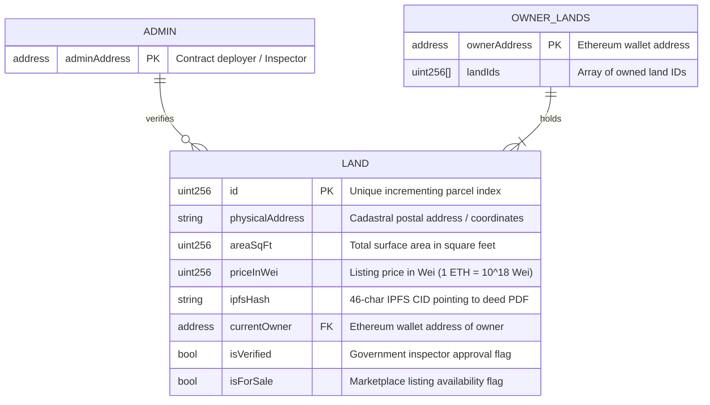

# 05. Database Schema & State Storage Models

## 1. Storage Architecture Overview

TerraChain does **not use a relational database** (e.g. PostgreSQL, MySQL) or a NoSQL document database (e.g. MongoDB). Instead, it adopts a **dual-tier decentralized storage architecture**:

1. **On-Chain State Storage**: The Ethereum Virtual Machine (EVM) storage slots allocate persistent contract state variables, mapping tables, and data structs.
2. **Off-Chain Content-Addressed Document Storage**: The InterPlanetary File System (IPFS) stores raw cadastral deed files (PDFs, boundary scans, legal certificates) referenced on-chain by their cryptographic Content Identifiers (CIDs).

---

## 2. On-Chain Data Model (`LandRegistry.sol`)

### Entity-Relationship Diagram



---

## 3. Storage Layout & Data Types

### Data Structure: `struct Land`
Defined in `blockchain/contracts/LandRegistry.sol:L28-39`:

| Field Name | Solidity Type | Byte Size (Approx) | Purpose & Constraints |
| :--- | :--- | :--- | :--- |
| `id` | `uint256` | 32 bytes | Unique integer identifier, incremented via `_totalLands`. |
| `physicalAddress` | `string` | Dynamic (heap/storage) | Detailed parcel location, survey number, and GPS boundaries. Non-empty. |
| `areaSqFt` | `uint256` | 32 bytes | Parcel land area. Must be `> 0`. |
| `priceInWei` | `uint256` | 32 bytes | Purchase price denominated in Wei. Initialized to `0` upon registration. |
| `ipfsHash` | `string` | Dynamic (approx 46 bytes) | Base58 or Base32 IPFS CID string representing the title deed file. |
| `currentOwner` | `address` | 20 bytes (padded to 32) | EVM address of legal title holder. Non-zero. |
| `isVerified` | `bool` | 1 byte | `true` if approved by government inspector; defaults to `false`. |
| `isForSale` | `bool` | 1 byte | `true` if actively listed on marketplace; defaults to `false`. |

### EVM Persistent State Variables
Defined in `blockchain/contracts/LandRegistry.sol:L43-47`:

```solidity
address public admin;                              // Slot 0: Government inspector address
uint256 private _totalLands;                       // Slot 1: Global land counter
mapping(uint256 => Land) private _lands;           // Slot 2: Main land records key-value table
mapping(address => uint256[]) private _ownerLands; // Slot 3: Owner to land ID array mapping
```

---

## 4. Off-Chain IPFS Document Model

Legal title deed documents are stored as immutable byte blobs on IPFS.

### Metadata Payload (Stored in Pinata metadata cache):
```json
{
  "name": "Deed_1713337200000_CadastralSurvey_402.pdf",
  "keyvalues": {
    "app": "TerraChain",
    "fileType": "application/pdf"
  }
}
```

### IPFS Content Identifier (CID)
- **Example CID**: `QmXoypizjW3WknFiJnKLwHCnL72vedxjQkDDP1mXWo6uco`
- **Hash Algorithm**: SHA-256 (multihash prefix `0x1220`)
- **Immutability Guarantee**: Any alteration to a single byte of the deed document will produce a completely different CID, instantly invalidating forged records when cross-referenced against the on-chain `ipfsHash`.

---

## 5. Storage Comparison: On-Chain vs Off-Chain

| Attribute | On-Chain (`LandRegistry.sol`) | Off-Chain (IPFS Pinata) |
| :--- | :--- | :--- |
| **Data Stored** | State flags, pricing, owner address, area, CID hash | PDF legal deeds, survey maps, photos |
| **Cost Model** | Expensive EVM Gas (~180,000 gas per land creation) | Zero gas (Pinata cloud plan / IPFS node bandwidth) |
| **Immutability** | Cryptographic EVM consensus guarantee | Content-addressed cryptographic hash guarantee |
| **Access Speed** | Instant JSON-RPC reading via local node | Dependent on IPFS gateway latency (~1-3s) |
| **Privacy** | 100% public to any blockchain observer | Publicly readable if CID is known via gateway |
