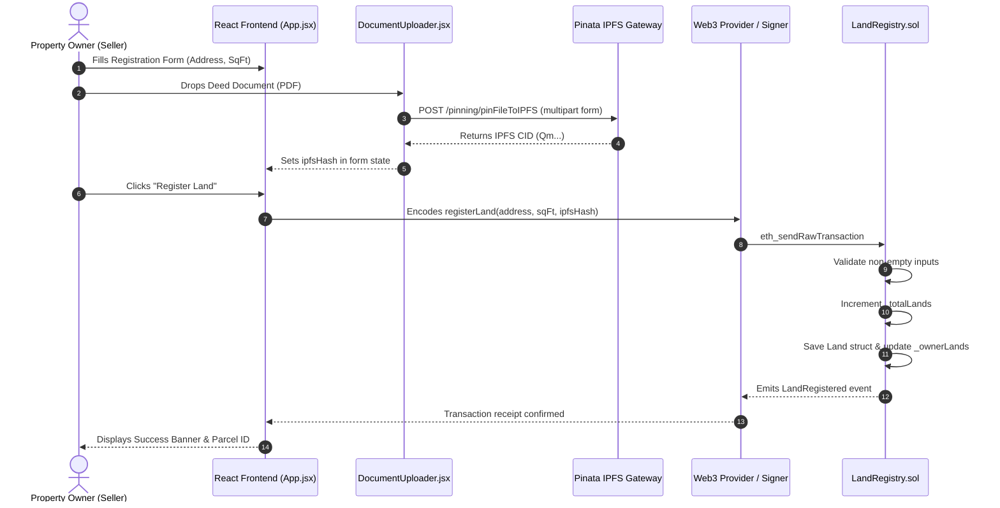
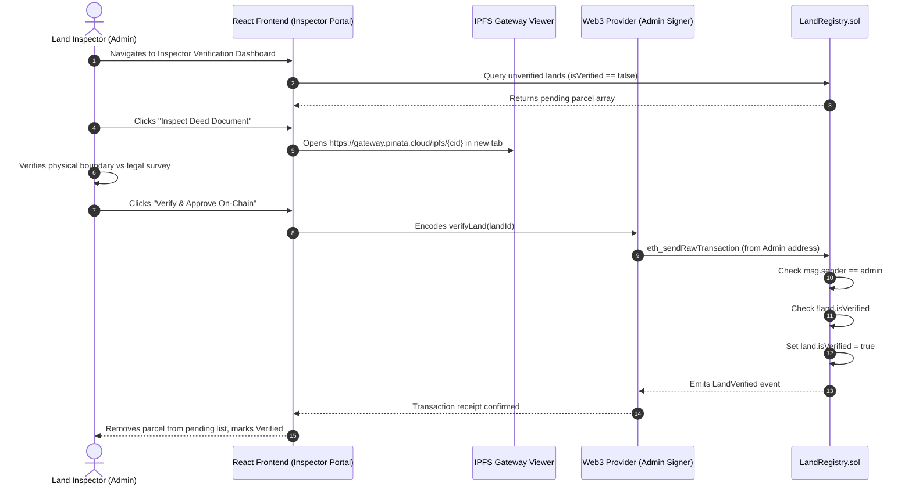
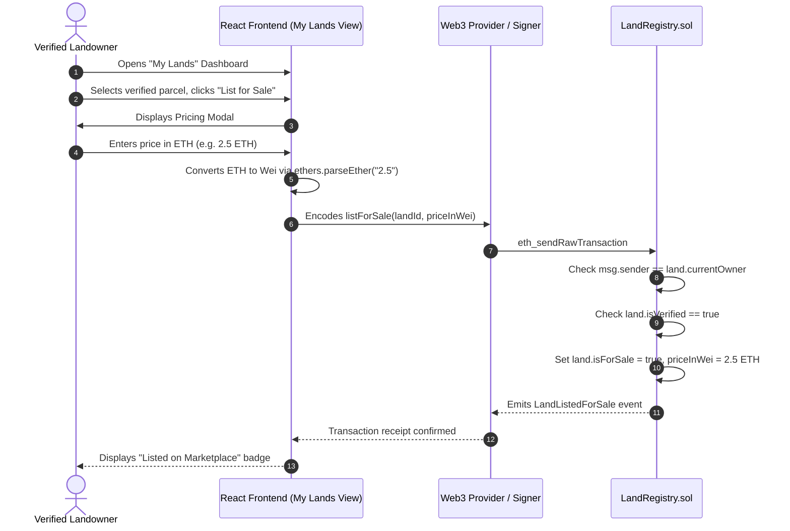

# 08. End-to-End Workflows & Sequence Diagrams

## 1. Land Registration Workflow



---

## 2. Government Verification Workflow



---

## 3. Marketplace Listing Workflow



---

## 4. Land Purchase & Settlement Workflow

```mermaid
sequenceDiagram
    autonumber
    actor Buyer as Prospective Buyer
    participant UI as React Frontend (Marketplace)
    participant Ethers as Web3 Provider (Buyer Signer)
    participant Contract as LandRegistry.sol
    actor Seller as Property Seller

    Buyer->>UI: Browses Marketplace, selects Listed Parcel
    Buyer->>UI: Clicks "Buy Now"
    UI->>Buyer: Displays Purchase Confirmation Modal (Price + Gas)
    Buyer->>UI: Confirms Purchase
    UI->>Ethers: Encodes buyLand(landId) with { value: priceInWei }
    Ethers->>Contract: eth_sendRawTransaction (nonReentrant)
    Contract->>Contract: Check land.isForSale == true
    Contract->>Contract: Check msg.value == land.priceInWei
    Contract->>Contract: Check msg.sender != land.currentOwner
    Contract->>Contract: Set land.isForSale = false
    Contract->>Contract: Set land.currentOwner = msg.sender
    Contract->>Contract: Update _ownerLands[msg.sender].push(landId)
    Contract->>Seller: Transfers native ETH via low-level call{value: msg.value}("")
    Seller-->>Contract: ETH received
    Contract-->>Ethers: Emits LandSold event
    Ethers-->>UI: Transaction receipt confirmed
    UI-->>Buyer: Shows Purchase Success Modal; parcel appears in "My Lands"
```
