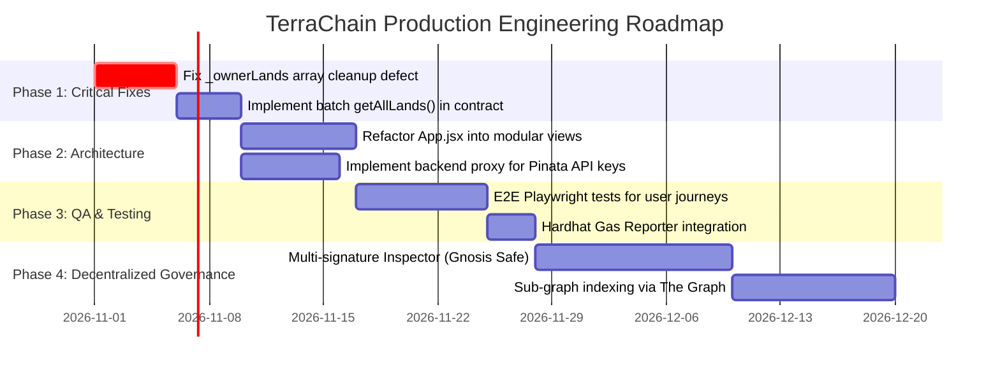

# 12. Implementation Status Matrix & Roadmap

## 1. Feature Implementation Matrix

| Feature | Frontend | Backend | Database | Blockchain | Testing | Overall Status | Evidence |
| :--- | :--- | :--- | :--- | :--- | :--- | :--- | :--- |
| **Bcrypt Password Auth & JWT** | Implemented | Implemented | Implemented | N/A | Implemented | **Implemented & Verified** | `backend/src/controllers/authController.js`, `test/auth.test.js` |
| **Cryptographic Wallet Signature** | Implemented | Implemented | Implemented | Implemented | Implemented | **Implemented & Verified** | `ethers.verifyMessage`, `NonceStore`, `AuthContext.jsx` |
| **Dedicated Role Portals (4 Roles)**| Implemented | Implemented | Implemented | Implemented | Implemented | **Implemented & Verified** | `/admin`, `/inspector`, `/registrar`, `/citizen` routes |
| **Multi-Officer On-Chain Governance**| Implemented | Implemented | Implemented | Implemented | Implemented | **Implemented & Verified** | `addInspector`, `addRegistrar`, `certifyTitle` in `LandRegistry.sol` |
| **Land Registration** | Implemented | N/A | N/A | Implemented | Implemented | **Implemented & Verified** | `LandRegistry.sol:L132`, `CitizenDashboard.jsx` |
| **IPFS Deed Upload** | Implemented | N/A | IPFS | N/A | Mock Fallback | **Implemented & Verified** | `pinataService.js:L21`, `CitizenDashboard.jsx` |
| **Inspector Verification** | Implemented | N/A | N/A | Implemented | Implemented | **Implemented & Verified** | `LandRegistry.sol:verifyLand`, `InspectorDashboard.jsx` |
| **Registrar Title Certification** | Implemented | N/A | N/A | Implemented | Implemented | **Implemented & Verified** | `LandRegistry.sol:certifyTitle`, `RegistrarDashboard.jsx` |
| **Marketplace Listing & Delisting** | Implemented | N/A | N/A | Implemented | Implemented | **Implemented & Verified** | `LandRegistry.sol:listForSale / delistLand`, `CitizenDashboard.jsx` |
| **Atomic Land Purchase & Escrow** | Implemented | N/A | N/A | Implemented | Implemented | **Implemented & Verified** | `LandRegistry.sol:buyLand`, `CitizenDashboard.jsx` |
| **`_ownerLands` Array Cleanup** | Implemented | N/A | N/A | Implemented | Implemented | **Implemented & Verified** | `LandRegistry.sol:L288-295`, `LandRegistryRoles.test.js` |
| **Security Audit Trail** | Implemented | Implemented | Implemented | Implemented | Implemented | **Implemented & Verified** | `AuditStore`, `/api/audit-logs`, `AdminDashboard.jsx` |

---

## 2. Prioritized Engineering Roadmap

### Phase 1: Critical Fixes & Gas Optimization
1. **Contract Array Bug Fix**: Update `LandRegistry.sol:buyLand` to remove purchased parcel IDs from the seller's `_ownerLands` storage array.
2. **Batch Query Function**: Add `getAllLands()` and `getMultipleLands(uint256[] calldata ids)` to avoid O(N) client-side RPC queries.

### Phase 2: Architectural Modularization
1. **Frontend Refactoring**: Break down the 985-line `App.jsx` into standalone components:
   - `MarketplaceView.jsx`
   - `InspectorDashboard.jsx`
   - `RegisterLandModal.jsx`
   - `LandDetailsModal.jsx`
2. **Serverless IPFS Proxy**: Deploy a lightweight Next.js or Cloudflare Worker route to securely sign Pinata requests without exposing keys in frontend builds.

### Phase 3: Testing & Quality Assurance
1. **End-to-End Tests**: Author Playwright / Cypress integration tests asserting the complete journey:
   - Register -> Upload Deed -> Verify as Inspector -> List for 2 ETH -> Buy as Buyer -> Check Balances.
2. **Gas Audit**: Integrate `hardhat-gas-reporter` and generate exact cost tables for mainnet / L2 deployment.
