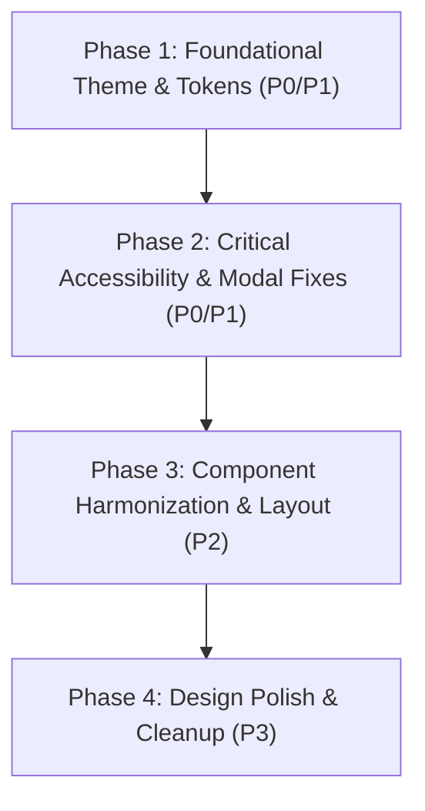

# 10. Prioritized UI Improvement Plan

## 1. Executive Summary

This document establishes the actionable backlog of user interface, styling, theme compatibility, and accessibility improvements for TerraChain (LandBlock). Every issue is assigned a unique identifier (`UI-xxx`), prioritized according to severity (P0 to P3), and documented with root causes, concrete remediation instructions, affected dependencies, and verification procedures.

### Priority Classifications:
- **P0 — Critical:** Unreadable legal text, inaccessible controls, or layout defects that physically block workflow completion.
- **P1 — High:** Major theme switching failures, unstyled fallback routes, modal clipping, or broken dashboard responsive layouts.
- **P2 — Medium:** Visual inconsistencies, typography weight balance, contrast improvements, component harmonization, and spacing defects.
- **P3 — Polish:** Micro-interactions, custom scrollbars, selection colors, subtle elevation shadows, and animation refinements.

---

## 2. Master Improvement Backlog

### P0 — Critical Issues

#### UI-001: Tailwind Class-Based Dark Mode Failure
| Field | Value |
|---|---|
| **Issue ID** | `UI-001` |
| **Page / Component** | Global Application (`tailwind.config.js`) |
| **Theme** | Both (Affects Dark Mode activation on Light OS) |
| **Viewport** | All Viewports |
| **Severity** | **P0 — Critical** |
| **Observed Issue** | Toggling the theme button on an operating system set to Light Mode changes the React state and adds `.dark` to the container `
`, but Tailwind fails to apply any `dark:` utility styles. Dark mode fails completely for users whose OS is set to Light. |
| **Evidence** | [`frontend/tailwind.config.js:L1-L28`](file:///c:/LandBlock/frontend/tailwind.config.js#L1-L28) (missing `darkMode: 'class'`) |
| **Root Cause** | Tailwind defaults to `media` mode when `darkMode` is not specified. |
| **Recommended Improvement** | Add `darkMode: 'class'` to `tailwind.config.js` root object. |
| **Dependencies** | Affects every component relying on `dark:` variants across the entire application. |
| **Verification** | Set OS theme to Light. Open TerraChain in browser. Click theme toggle button. Verify all backgrounds turn to `#020617` and cards adapt to `#0f172a`. |

---

#### UI-002: Unreadable Status Badges in Light Mode
| Field | Value |
|---|---|
| **Issue ID** | `UI-002` |
| **Page / Component** | Data Tables across all dashboards (`AdminDashboard.jsx`, `InspectorDashboard.jsx`, `RegistrarDashboard.jsx`, `CitizenDashboard.jsx`) |
| **Theme** | Light Mode |
| **Viewport** | All Viewports |
| **Severity** | **P0 — Critical** |
| **Observed Issue** | Status badges (Pending, Approved, Rejected, Certified) use translucent colors (`text-amber-500`, `text-emerald-500`, `text-purple-400`). On white cards in Light Mode, contrast drops to 2.1:1–2.8:1, rendering legal parcel statuses illegible. |
| **Evidence** | `CitizenDashboard.jsx:L268`, `InspectorDashboard.jsx:L248`, `RegistrarDashboard.jsx:L224` |
| **Root Cause** | Badges use dark-theme translucent alpha classes with no light-mode text alternatives. |
| **Recommended Improvement** | Replace with dual-token classes: `bg-amber-100 text-amber-900 border-amber-300 dark:bg-amber-500/15 dark:text-amber-400 dark:border-amber-500/30`. Apply corresponding pairs for emerald, rose, and purple badges. |
| **Dependencies** | Shared badge styling or dedicated `<StatusBadge />` component. |
| **Verification** | Inspect all status badges in Light Mode using Chrome DevTools Accessibility Inspector to ensure contrast ratio ≥ 4.5:1. |

---

#### UI-003: Property Registration Modal Overflow Blocks Form Submission
| Field | Value |
|---|---|
| **Issue ID** | `UI-003` |
| **Page / Component** | Property Registration Modal in `CitizenDashboard.jsx` |
| **Theme** | Both |
| **Viewport** | Laptops (1366×768) and Mobile (<768px) |
| **Severity** | **P0 — Critical** |
| **Observed Issue** | The modal contains over 10 form fields arranged vertically without an internal scrolling container. On screens shorter than 850px, the bottom buttons (`Submit Application`, `Cancel`) extend below the viewport and cannot be clicked. |
| **Evidence** | [`CitizenDashboard.jsx:L425-L440`](file:///c:/LandBlock/frontend/src/components/CitizenDashboard.jsx#L425-L440) |
| **Root Cause** | Modal inner card lacks `max-h-[85vh]` and `overflow-y-auto`. |
| **Recommended Improvement** | Add `max-h-[85vh] flex flex-col` to modal wrapper, wrap form fields in `overflow-y-auto pr-2`, and keep action buttons pinned in a non-scrolling footer `pt-4 border-t`. |
| **Dependencies** | Citizen Dashboard modal markup. |
| **Verification** | Open Property Registration Modal in a browser resized to 1366×768 and 375×667. Verify submit button is immediately visible or accessible via internal modal scrollbar. |

---

### P1 — High Priority Issues

#### UI-004: Hardcoded Dark Mode in `ProtectedRoute.jsx`
| Field | Value |
|---|---|
| **Issue ID** | `UI-004` |
| **Page / Component** | `ProtectedRoute.jsx` (Access Denied / Loading screens) |
| **Theme** | Light Mode |
| **Viewport** | All Viewports |
| **Severity** | **P1 — High** |
| **Observed Issue** | When an unauthorized user navigates to a protected dashboard in Light Mode, the error screen renders with hardcoded `bg-slate-950 text-white`, blindingly contradicting the user's active light theme. |
| **Evidence** | [`ProtectedRoute.jsx:L16-L45`](file:///c:/LandBlock/frontend/src/components/ProtectedRoute.jsx#L16-L45) |
| **Root Cause** | Classes are hardcoded dark values with zero light-mode variants. |
| **Recommended Improvement** | Update container to `bg-slate-50 dark:bg-slate-950 text-slate-900 dark:text-white` and card to `bg-white dark:bg-slate-900 border-slate-200 dark:border-slate-800`. |
| **Dependencies** | `ProtectedRoute.jsx` component. |
| **Verification** | In Light Mode, navigate directly to `/admin` while logged in as a Citizen. Verify the Access Denied screen renders with a crisp light theme. |

---

#### UI-005: Theme State Prop-Drilling & Document Root Class Separation
| Field | Value |
|---|---|
| **Issue ID** | `UI-005` |
| **Page / Component** | `App.jsx`, Navigation bars |
| **Theme** | Both |
| **Viewport** | All Viewports |
| **Severity** | **P1 — High** |
| **Observed Issue** | `.dark` is applied to an inner `
` instead of `document.documentElement`. Theme props are manually drilled through every route. Browser overscroll and third-party portal backdrops retain light backgrounds. |
| **Evidence** | [`App.jsx:L104-L108`](file:///c:/LandBlock/frontend/src/App.jsx#L104-L108) |
| **Root Cause** | Absence of a centralized `ThemeContext` and failure to toggle class on `document.documentElement`. |
| **Recommended Improvement** | Implement a `ThemeProvider` context. In the provider's `useEffect`, toggle `document.documentElement.classList.toggle('dark', isDarkMode)`. Export a `useTheme()` hook. |
| **Dependencies** | All dashboards and navigation components consuming `toggleTheme`. |
| **Verification** | Check `<html>` tag in DOM tree to verify `.dark` class toggles directly on root. Inspect overscroll areas. |

---

#### UI-006: Flash of Unstyled Content (FOUC) on Reload
| Field | Value |
|---|---|
| **Issue ID** | `UI-006` |
| **Page / Component** | Initial Document Shell (`index.html`) |
| **Theme** | Dark Mode |
| **Viewport** | All Viewports |
| **Severity** | **P1 — High** |
| **Observed Issue** | Reloading any dashboard in Dark Mode causes a brief (150ms–350ms) bright white screen flash before React hydrates and reapplies dark styling. |
| **Evidence** | [`index.html:L1-L20`](file:///c:/LandBlock/frontend/index.html#L1-L20) |
| **Root Cause** | HTML head lacks an inline pre-render script to read `localStorage` and apply `.dark` to `document.documentElement` before layout paint. |
| **Recommended Improvement** | Add an inline `<script>` in `<head>` that immediately checks `localStorage.getItem('terra_theme')` and adds `dark` to `<html>` if active. |
| **Dependencies** | `index.html`. |
| **Verification** | In Dark Mode, perform a hard refresh (Ctrl+F5). Verify zero white flash occurs during page load. |

---

#### UI-007: Horizontal Tab Bar Overflow on Mobile Citizen Dashboard
| Field | Value |
|---|---|
| **Issue ID** | `UI-007` |
| **Page / Component** | Tab navigation in `CitizenDashboard.jsx` |
| **Theme** | Both |
| **Viewport** | Mobile (360px–480px) |
| **Severity** | **P1 — High** |
| **Observed Issue** | The 4 navigation tabs (`My Properties`, `Marketplace`, `Pending`, `Transfers`) are displayed in a non-wrapping flex row. On mobile, tab text squishes together and overflows off the screen edge. |
| **Evidence** | [`CitizenDashboard.jsx:L220-L245`](file:///c:/LandBlock/frontend/src/components/CitizenDashboard.jsx#L220-L245) |
| **Root Cause** | Missing `overflow-x-auto no-scrollbar` or responsive grid wrapping. |
| **Recommended Improvement** | Add `overflow-x-auto whitespace-nowrap scrollbar-none py-1` to the tab container and `flex-shrink-0` to individual tab buttons. |
| **Dependencies** | Citizen dashboard layout. |
| **Verification** | View Citizen Dashboard on 360px viewport. Verify tabs scroll smoothly horizontally without clipping text. |

---

### P2 — Medium Priority Issues

#### UI-008: Inconsistent Action Button Styling on Inspector Portal
| Field | Value |
|---|---|
| **Issue ID** | `UI-008` |
| **Page / Component** | `InspectorDashboard.jsx` |
| **Theme** | Both |
| **Viewport** | All Viewports |
| **Severity** | **P2 — Medium** |
| **Observed Issue** | Inspector buttons use `bg-amber-500 text-slate-950 font-black` while all other dashboards use `text-white font-bold`. The intense black text on amber causes the button to look like a hazard alert rather than an affirmative action. |
| **Evidence** | [`InspectorDashboard.jsx:L225`](file:///c:/LandBlock/frontend/src/components/InspectorDashboard.jsx#L225) |
| **Root Cause** | Ad-hoc role styling without unified design system button rules. |
| **Recommended Improvement** | Harmonize Inspector primary buttons to `bg-amber-500 hover:bg-amber-600 text-white font-bold` or use high-contrast dark tokens consistently. |
| **Dependencies** | Inspector Dashboard actions. |
| **Verification** | Visually compare Inspector buttons alongside Admin and Registrar buttons for visual rhythm. |

---

#### UI-009: Missing Accessible Names (ARIA) on Icon Buttons
| Field | Value |
|---|---|
| **Issue ID** | `UI-009` |
| **Page / Component** | Theme Toggle Buttons, Modal Close Buttons, Table Quick Actions |
| **Theme** | Both |
| **Viewport** | All Viewports |
| **Severity** | **P2 — Medium** |
| **Observed Issue** | Interactive buttons containing only Lucide SVG icons have no text content or `aria-label`. Screen reader users hear only `"Button"`. |
| **Evidence** | `AdminDashboard.jsx:L108`, `CitizenDashboard.jsx:L122`, `InspectorDashboard.jsx:L102` |
| **Root Cause** | Missing `aria-label` attributes on icon-only JSX buttons. |
| **Recommended Improvement** | Add `aria-label="Toggle theme"` to theme buttons, `aria-label="Close dialog"` to modal close buttons, and descriptive labels to table actions. |
| **Dependencies** | Navigation and modal components. |
| **Verification** | Run an automated axe-core / Lighthouse accessibility audit; confirm 0 "Buttons do not have an accessible name" violations. |

---

#### UI-010: Native `<select>` Dropdown Styling Contrast on Windows
| Field | Value |
|---|---|
| **Issue ID** | `UI-010` |
| **Page / Component** | Filter bars and registration forms across all dashboards |
| **Theme** | Dark Mode |
| **Viewport** | Desktop (Windows / Chrome) |
| **Severity** | **P2 — Medium** |
| **Observed Issue** | Native `<select>` inputs render with dark backgrounds, but expanding the menu on Windows renders un-styled white option lists. |
| **Evidence** | `CitizenDashboard.jsx:L465`, `InspectorDashboard.jsx:L215` |
| **Root Cause** | Reliance on browser native `<select>` without explicit CSS option backgrounds or a custom dropdown. |
| **Recommended Improvement** | Style `<option>` tags with explicit `bg-white dark:bg-slate-900 text-slate-900 dark:text-white`, or implement an accessible lightweight headless dropdown. |
| **Dependencies** | Form input components. |
| **Verification** | Expand select dropdowns on Windows Chrome in Dark Mode; verify option lists blend seamlessly. |

---

### P3 — Polish & Refinements

#### UI-011: Text Selection Highlight Color Disconnect
| Field | Value |
|---|---|
| **Issue ID** | `UI-011` |
| **Page / Component** | Global CSS (`index.css`) |
| **Theme** | Both |
| **Viewport** | All Viewports |
| **Severity** | **P3 — Polish** |
| **Observed Issue** | Highlighting text triggers an indigo selection highlight (`selection:bg-indigo-600`) which clashes with the platform's primary emerald branding. |
| **Evidence** | [`frontend/src/index.css:L34-L37`](file:///c:/LandBlock/frontend/src/index.css#L34-L37) |
| **Root Cause** | Hardcoded legacy CSS rule. |
| **Recommended Improvement** | Change selection rule to `selection:bg-emerald-500 selection:text-slate-950`. |
| **Dependencies** | `index.css`. |
| **Verification** | Highlight text on any page in both themes. |

---

#### UI-012: Deprecated Legacy Files Cleanup
| Field | Value |
|---|---|
| **Issue ID** | `UI-012` |
| **Page / Component** | `frontend/src/components/LoginPage.jsx` and `DocumentUploader.jsx` |
| **Theme** | N/A |
| **Viewport** | N/A |
| **Severity** | **P3 — Polish** |
| **Observed Issue** | Two unreferenced components totaling 886 lines of code contain hardcoded mock private keys and outdated styling. |
| **Evidence** | `LoginPage.jsx` (525 lines), `DocumentUploader.jsx` (361 lines) |
| **Root Cause** | Abandoned prototype code retained during role-auth refactor. |
| **Recommended Improvement** | Safely archive or remove orphaned files during code cleanup phase. |
| **Dependencies** | Build bundle size and developer clarity. |
| **Verification** | Confirm zero imports exist in `App.jsx` and build succeeds. |

---

## 3. Recommended Phased Implementation Roadmap

### Phase 1: Foundational Theme & Tokens (Immediate Priority)
1. Add `darkMode: 'class'` to `tailwind.config.js` (`UI-001`).
2. Add inline pre-render script to `index.html` to eliminate FOUC (`UI-006`).
3. Implement `ThemeContext` and mount `.dark` directly on `document.documentElement` (`UI-005`).
4. Replace Light Mode status badge color tokens across all dashboards (`UI-002`).

### Phase 2: Critical Accessibility & Modal Fixes
1. Fix modal height clipping and add internal scrolling to Property Registration Modal (`UI-003`).
2. Theme-enable `ProtectedRoute.jsx` so unauthorized users see an appropriate theme (`UI-004`).
3. Add `aria-label` attributes to all icon-only buttons (`UI-009`).
4. Implement mobile scrolling on the Citizen Dashboard tab bar (`UI-007`).

### Phase 3: Component Harmonization & Layout
1. Standardize Inspector button styling and typography (`UI-008`).
2. Unify form input focus states with high-contrast rings.
3. Apply dark styles to native `<option>` dropdown menus (`UI-010`).
4. Harmonize stat card padding and font weights.

### Phase 4: Polish & Refinements
1. Update selection highlight to emerald (`UI-011`).
2. Remove orphaned files `LoginPage.jsx` and `DocumentUploader.jsx` (`UI-012`).
3. Add subtle micro-transitions and smooth hover elevations to all dashboard cards.
